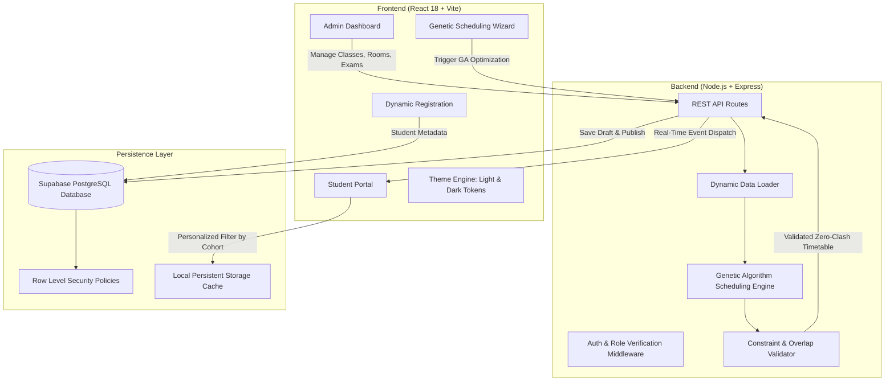

# 🎓 ExamSync — Automated Examination Scheduling & Room Allocation Platform

[](https://react.dev/)
[](https://nodejs.org/)
[](https://supabase.com/)
[-8a2be2)](https://github.com/)
[-4263eb)](https://github.com/)

> **ExamSync** is an institutional examination timetable scheduling and room allocation system engineered for higher education institutions. It automates complex schedule generation using a **Genetic Algorithm (GA)**, eliminating student timetable clashes, room capacity overruns, and double-booking while providing real-time synchronization between academic administrators and student portals.

---

## 📌 Table of Contents

- [What ExamSync Does & How It Works](#-what-examsync-does--how-it-works)
- [System Architecture](#-system-architecture)
- [Technology Stack (Which Tech for What)](#-technology-stack-which-tech-for-what)
- [Core Features](#-core-features)
  - [1. Genetic Algorithm Scheduling Engine](#1-genetic-algorithm-scheduling-engine)
  - [2. Dynamic Student Registration & Multi-Cohort Support](#2-dynamic-student-registration--multi-cohort-support)
  - [3. Real-Time Administrative & Student Portals](#3-real-time-administrative--student-portals)
  - [4. Premium Light & Dark Design System](#4-premium-light--dark-design-system)
- [Directory Structure](#-directory-structure)
- [Security & Environment Hygiene](#-security--environment-hygiene)
- [Getting Started](#-getting-started)
  - [Prerequisites](#prerequisites)
  - [1. Clone Repository](#1-clone-repository)
  - [2. Database Setup](#2-database-setup)
  - [3. Backend Configuration & Start](#3-backend-configuration--start)
  - [4. Frontend Configuration & Start](#4-frontend-configuration--start)
- [Automated Testing](#-automated-testing)
- [License](#-license)

---

## 🔍 What ExamSync Does & How It Works

Examination scheduling in universities and autonomous colleges is an **NP-hard constraint satisfaction problem**. Manually coordinating hundreds of courses, exam sessions, cohorts, room capacities, and faculty leads to conflicts, student complaints, and room double-bookings.

ExamSync solves this by:
1. **Constraint Ingestion**: Ingests registered cohorts (FE, SE, TE, BE across all engineering branches), enrolled courses, exam rooms/venues with physical capacities, and available date windows and session slots.
2. **Genetic Algorithm Optimization**:
   - Evolves populations of exam chromosomes across multiple generations.
   - Evaluates hard constraints (zero student clashes, zero room double-booking, 100% capacity fit, minimum 24-hour study gap).
   - Optimizes soft constraints (minimizing consecutive exam days, morning preference for core units, department venue proximity).
3. **Dynamic Real-Time Reflection**:
   - Once a schedule is generated or published by the administrator, changes are instantly synchronized with student dashboards.
   - Students register dynamically by selecting their **Academic Year (FE/SE/TE/BE)**, **Branch/Department**, **Division**, and **Roll Number**.
   - The student portal automatically personalizes to display their specific examination schedule, venue halls, and downloadable admit card passes.

---

## 🏗 System Architecture



---

## 🛠 Technology Stack (Which Tech for What)

| Layer / Component | Technology | Purpose & Responsibility |
|---|---|---|
| **Frontend Framework** | **React 18** | Modular component architecture, hooks (`useCallback`, `useMemo`, `useState`), role-based routing, and dynamic data binding. |
| **Build Tool & Bundler** | **Vite** | Ultra-fast Hot Module Replacement (HMR), optimized production asset building and minification. |
| **Styling & Theming** | **Vanilla CSS + Design Tokens** | Flexible design system in `tokens.css` with zero UI bloat. Provides clean, elegant Light Theme (`#F8FAFF`) and sophisticated Dark Theme (`#0A1020`). |
| **Backend Runtime** | **Node.js** | Non-blocking asynchronous JavaScript runtime powering the server API. |
| **Backend Framework** | **Express.js** | RESTful routing, request parsing, security headers, CORS management, and error handling. |
| **Optimization Engine** | **Custom Genetic Algorithm** | Deterministic PRNG seed, tournament selection, uniform crossover, adaptive gene mutation, and multi-objective constraint evaluation. |
| **Database** | **PostgreSQL** (via Supabase) | Relational persistence for profiles, academic classes, courses, room capacities, sessions, notifications, and timetables. |
| **Authentication & RLS** | **Supabase Auth** | User authentication, JWT verification, and PostgreSQL Row Level Security (RLS) policies enforcing role isolation (Admins vs Students). |
| **Data Export** | **CSV & Print CSS** | Client-side CSV timetable export and print styles for physical exam hall passes and admit cards. |
| **Testing** | **Node.js Native Test Runner** (`node --test`) | Unit and integration testing verifying timetable routes, error handling, GA constraint satisfaction, and PRNG reproducibility. |

---

## 🚀 Core Features

### 1. Genetic Algorithm Scheduling Engine
- **Zero-Clash Hard Constraints**:
  - `STUDENT_EXAM_CLASH`: Prevents overlapping exams for students enrolled in identical courses.
  - `ROOM_DOUBLE_BOOKING`: Ensures no room is assigned to multiple exams simultaneously.
  - `CAPACITY_OVERFLOW`: Verifies student count strictly fits within room capacity.
  - `GAP_VIOLATION`: Ensures minimum buffer spacing between consecutive papers.
- **Configurable Settings**: Administrators can tune population size, max generations, mutation probability, and optimization modes (Fast Execution vs Balanced Optimization).

### 2. Dynamic Student Registration & Multi-Cohort Support
- **Dynamic Year & Branch Selection**:
  - Academic Years: **FE** (First Year), **SE** (Second Year), **TE** (Third Year), **BE** (Final Year).
  - Departments: **CMPN** (Computer Engineering), **INFT** (Information Technology), **EXTC** (Electronics & Telecommunication), **ECS** (Electronics & Computer Science), **BIOM** (Biomedical Engineering).
  - Divisions: **A**, **B**, **C**.
  - Roll Number / Candidate ID input.
- **Custom Institutional Data**: Supports scheduling for created subjects and rooms, avoiding reliance on static fixed mocks.

### 3. Real-Time Administrative & Student Portals
- **Admin Capabilities**:
  - Manage classes, subjects, rooms, and academic calendar sessions.
  - Interactive Step-by-Step Scheduling Wizard with validation diagnostics.
  - Manual timetable slot adjustments with inline venue reassignment.
  - One-click timetable publishing with automated student notifications.
- **Student Capabilities**:
  - Dynamic timetable personalized to the candidate's registered year and branch.
  - Filter by examination day or course code.
  - Official printable admit cards with examination desk allocations and verified candidate QR passes.

### 4. Premium Light & Dark Design System
- **Light Mode — Elegant White Theme**:
  - Background: `#F8FAFF` with subtle blue-indigo gradients (`linear-gradient(135deg, #FFFFFF 0%, #F4F7FF 55%, #EDF2FF 100%)`).
  - Cards & primary surfaces: `#FFFFFF` with soft borders (`#E1E8F2`) and dark text (`#17233D`).
  - Primary button gradient: `linear-gradient(135deg, #4263EB 0%, #7058D8 100%)`.
- **Dark Mode — Sophisticated Dark Theme**:
  - Background: `#0A1020` with deep navy gradients (`linear-gradient(135deg, #0A1020 0%, #10172B 55%, #17152F 100%)`).
  - Cards & primary surfaces: `#111A2E`, `#172238`, `#1B2942` with `#293852` borders and `#F1F5FF` text.
  - Primary button gradient: `linear-gradient(135deg, #5577F8 0%, #8067E8 100%)`.

---

## 📁 Directory Structure

```text
ExamSync/
├── .gitignore                      # Top-level git ignore rules (.env, node_modules, dist)
├── README.md                       # Comprehensive project documentation
│
├── backend/                        # Express.js REST API & Genetic Algorithm Engine
│   ├── .env.example                # Sanitized backend environment variable template
│   ├── package.json                # Backend dependencies and test scripts
│   ├── src/
│   │   ├── app.js                  # Express app initialization & route registration
│   │   ├── server.js               # HTTP server entry point (Port 5000)
│   │   ├── config/
│   │   │   └── supabase.js         # Singleton Supabase backend client configuration
│   │   ├── controllers/
│   │   │   └── timetableController.js # Timetable generation, drafts & publishing endpoints
│   │   ├── middleware/
│   │   │   └── auth.js             # JWT bearer authentication & admin override guard
│   │   ├── routes/
│   │   │   └── timetableRoutes.js  # /api/timetable endpoints definition
│   │   └── services/
│   │       ├── dataLoader.js       # Dynamic loader for database & institutional input data
│   │       └── scheduler.js        # Genetic Algorithm scheduler & constraint validator
│   └── test/
│       └── scheduler.test.js       # Automated tests (API endpoints & Genetic Algorithm)
│
├── database/                       # PostgreSQL migrations & security policies
│   ├── README.md                   # Database setup & deployment instructions
│   └── migrations/
│       ├── 001_initial_schema.sql  # Tables, constraints, foreign keys, indexes
│       ├── 002_security_rls.sql    # Row Level Security (RLS) policies & triggers
│       ├── 003_seed_data.sql       # Baseline institutional development dataset
│       ├── 004_auth_enhancements.sql # Fallback profile insertion trigger policy
│       └── 005_vit_academic_seed.sql # Idempotent seed for VIT academic hierarchy
│
└── frontend/                       # React 18 + Vite Single Page Application
    ├── .env.example                # Sanitized frontend environment variable template
    ├── index.html                  # HTML entry point with Plus Jakarta Sans & JetBrains Mono
    ├── package.json                # Frontend dependencies and build scripts
    ├── vite.config.js              # Vite bundler configuration
    └── src/
        ├── App.jsx                 # Application routing, theme state & role-guard wrappers
        ├── index.css               # Global base styles, scrollbars, background gradients
        ├── components/
        │   ├── admin/              # Admin layouts, topbar, sidebar, modals, data tables
        │   ├── auth/               # ProtectedRoute role guards
        │   ├── common/             # Official print headers, footers & export components
        │   ├── landing/            # Landing page hero, preview table, how-it-works sections
        │   ├── layout/             # Navigation bars & public layout containers
        │   ├── student/            # Student portal sidebar, topbar & layout wrappers
        │   └── ui/                 # Reusable buttons, inputs, badges, cards & SVG icons
        ├── context/
        │   ├── AuthContext.jsx     # Authentication context with dynamic student signup
        │   └── useAuth.js          # Authentication consumer hook
        ├── data/
        │   ├── adminDemoData.js    # Fictional VIT baseline academic demo data
        │   └── studentDemoData.js  # Fictional VIT baseline student demo data
        ├── lib/
        │   └── supabase.js         # Frontend Supabase client initialization
        ├── pages/
        │   ├── LandingPage.jsx     # Landing page with interactive preview & engine stats
        │   ├── RegisterPage.jsx    # Student registration form (Year, Branch, Div, Roll No)
        │   ├── StudentLoginPage.jsx# Student authentication screen
        │   ├── AdminLoginPage.jsx  # Administrator authentication screen
        │   ├── admin/              # Admin management pages (Timetable, Rooms, Exams, etc.)
        │   └── student/            # Student dashboard, timetable & course views
        ├── services/               # API clients for academics, rooms, timetables, generator
        ├── styles/                 # Centralized CSS design tokens, admin, student, print CSS
        └── utils/                  # Institution settings, CSV export & formatting helpers
```

---

## 🔒 Security & Environment Hygiene

- **Zero Secret Leaks**: Active credentials and secret keys are stored strictly in local `.env` / `.env.local` files, which are ignored by `.gitignore`.
- **Public Templates**: Only `.env.example` templates containing generic placeholders (`https://your-project.supabase.co`, `your_supabase_anon_key_here`) are committed to version control.
- **Row Level Security (RLS)**: Enforced directly inside PostgreSQL so students can only read published timetables and view their personal data, while schedule mutation is strictly restricted to administrator roles.

---

## 💻 Getting Started

### Prerequisites
- [Node.js](https://nodejs.org/) (v18.0.0 or higher recommended)
- `npm` (v9.0.0 or higher)
- A free [Supabase](https://supabase.com/) project (PostgreSQL + Auth)

---

### 1. Clone Repository

```bash
git clone https://github.com/your-username/ExamSync.git
cd ExamSync
```

---

### 2. Database Setup

1. Open your Supabase project dashboard and navigate to the **SQL Editor**.
2. Execute the migration scripts in order:
   - `database/migrations/001_initial_schema.sql` (Creates schema tables)
   - `database/migrations/002_security_rls.sql` (Enables Row Level Security)
   - `database/migrations/005_vit_academic_seed.sql` (Seeds classes, rooms & curriculum)
3. To promote an account to Institutional Administrator:
   ```sql
   UPDATE public.profiles
   SET role = 'admin'
   WHERE email = 'your-admin-email@your-domain.edu';
   ```

---

### 3. Backend Configuration & Start

```bash
cd backend

# 1. Create your local environment file from the template
cp .env.example .env

# 2. Update .env with your configuration:
# PORT=5000
# SUPABASE_URL=https://<your-project-ref>.supabase.co
# SUPABASE_SERVICE_ROLE_KEY=<your-service-role-key>

# 3. Install dependencies
npm install

# 4. Start the Express backend server
npm run dev
```

*The backend server will run on `http://localhost:5000`.*

---

### 4. Frontend Configuration & Start

Open a new terminal window:

```bash
cd frontend

# 1. Create your local environment file from the template
cp .env.example .env

# 2. Update .env with your Supabase credentials:
# VITE_SUPABASE_URL=https://<your-project-ref>.supabase.co
# VITE_SUPABASE_ANON_KEY=<your-anon-publishable-key>
# VITE_BACKEND_URL=http://localhost:5000

# 3. Install dependencies
npm install

# 4. Start Vite development server
npm run dev
```

*The frontend application will run on `http://localhost:5173`.*

---

## 🧪 Automated Testing

ExamSync includes automated unit and integration tests covering backend API contracts and the Genetic Algorithm constraint satisfaction engine:

```bash
cd backend
npm test
```

### Test Coverage Highlights:
- ✅ Service health check (`GET /`)
- ✅ Unauthorized request rejection (`401`)
- ✅ Parameter validation on generation & publishing (`400`)
- ✅ Time interval overlap detection (exact & partial intersections)
- ✅ Deterministic PRNG reproducibility
- ✅ Constraint satisfaction verification (0 hard violations)
- ✅ Student clash detection & room double-booking prevention
- ✅ Room capacity overflow detection
- ✅ Genetic Algorithm fitness convergence over generations

To test the frontend production build:
```bash
cd frontend
npm run build
```

---

## 📄 License

This project is licensed under the [MIT License](LICENSE).
